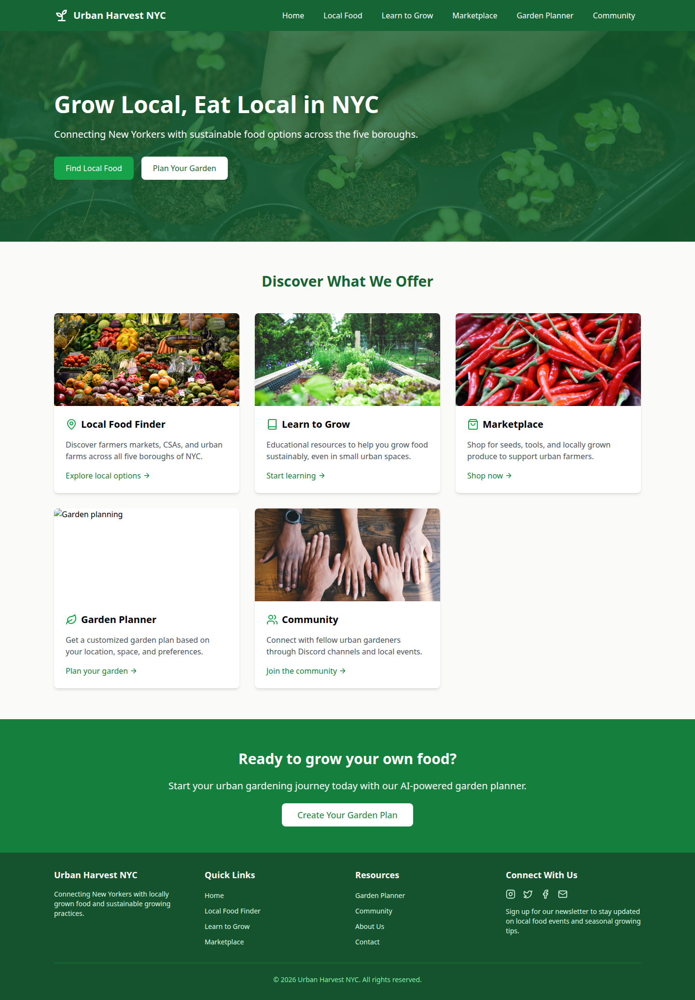
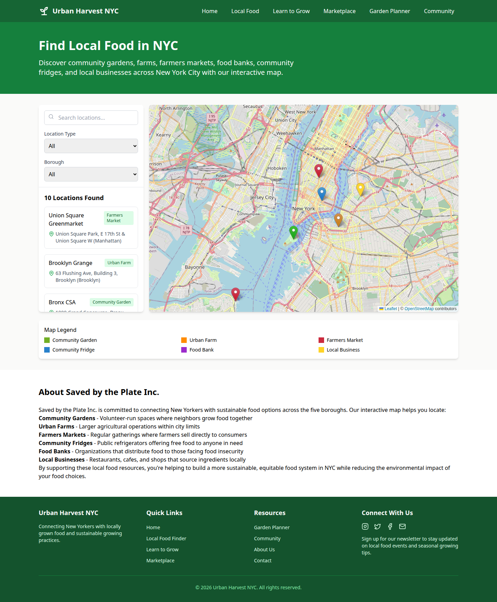
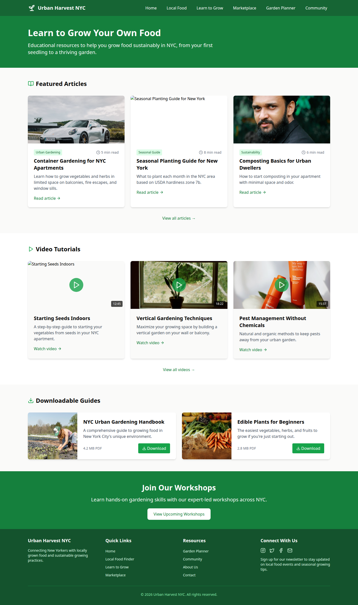
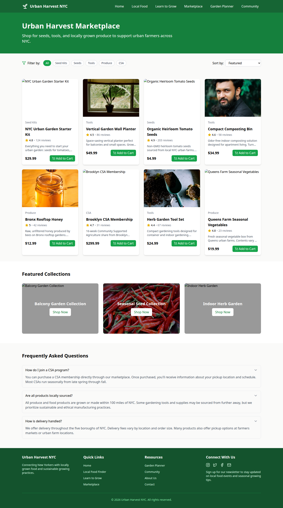
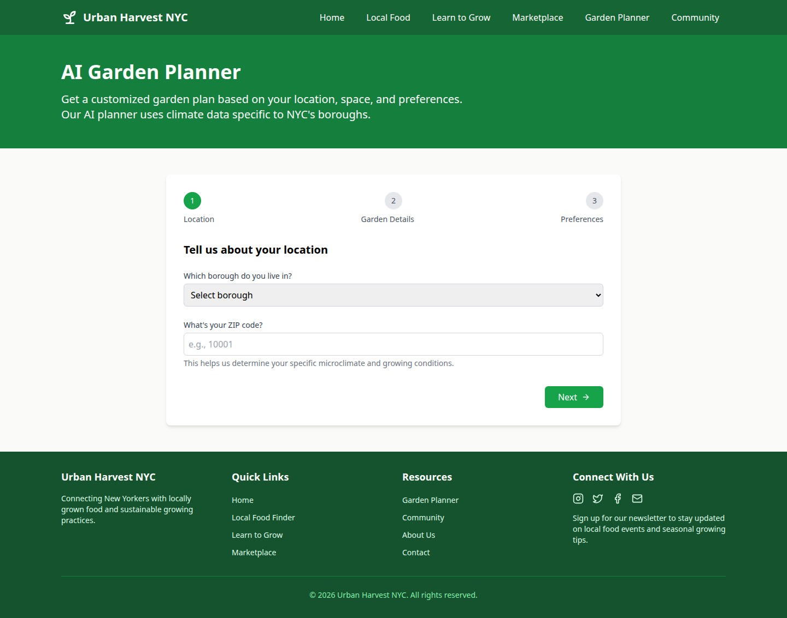
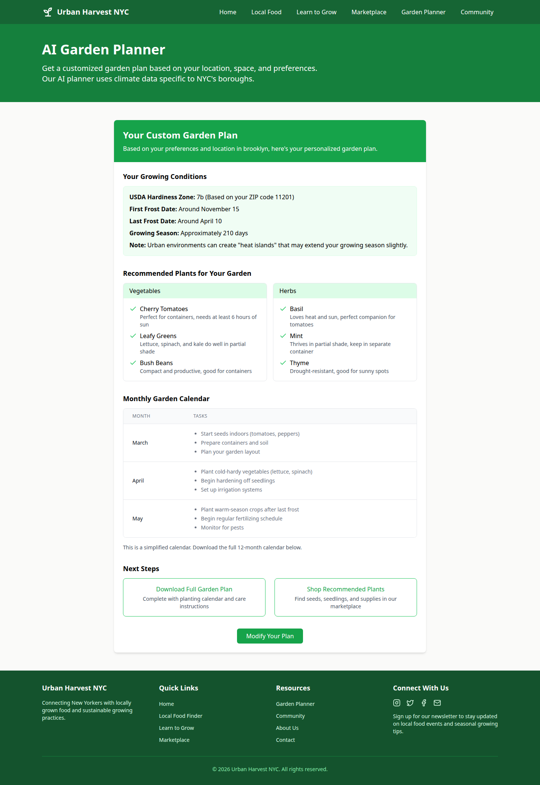
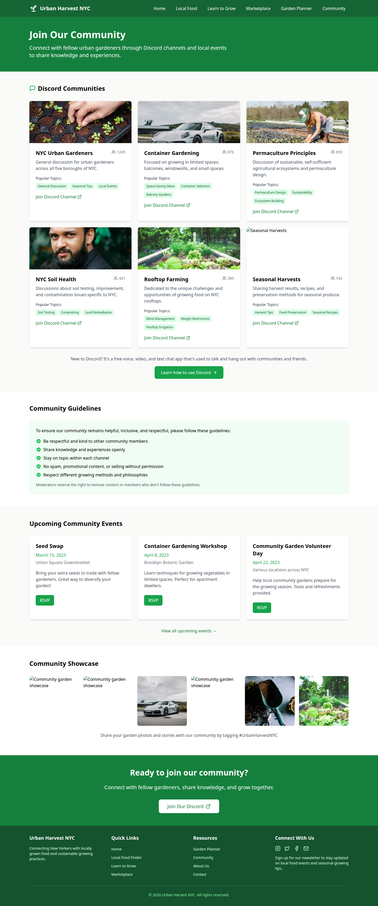
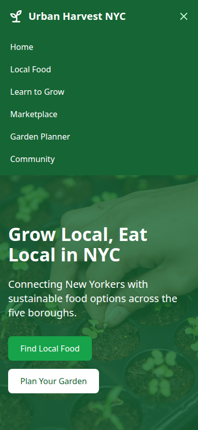

# Urban Harvest NYC

A UX and frontend design exploration for [Saved by the Plate](https://savedbytheplate.org), a food-justice education nonprofit. The interface in this repository is branded **Urban Harvest NYC**. It sketches an NYC local-food experience: find food resources on a map, read growing guides, browse a marketplace, walk through a garden plan, and see a community page.

This repository is the design exploration. The site implementation lives in [shaythegay13/savedbytheplate](https://github.com/shaythegay13/savedbytheplate).

The screen copy on the local food finder includes a section titled “About Saved by the Plate Inc.” The navigation wordmark, footer, and document title use Urban Harvest NYC.

## Design direction

The prototype is one visual system, shared by every page:

- Green interface on a warm gray page. Navbar is `green-800`, heroes and closing bands are `green-700` or `green-800`, the footer is `green-900`, the page background is `stone-50`, and cards are white with a light shadow.
- A sprout icon and the words “Urban Harvest NYC” as the wordmark (`lucide-react`).
- Centered content at `max-w-7xl`, with single-column layouts on small screens and two- to four-column grids from the `md` and `lg` breakpoints.
- Photography loaded from Unsplash URLs embedded in the page components.
- Client-side interaction only: filters, a mobile menu, a three-step form, and a Leaflet map. There is no API client and no environment configuration.

The files were synced from [Magic Patterns](https://magicpatterns.com) for the design [Interactive NYC Food Resource Map](https://www.magicpatterns.com/c/ejjyxdvsmbqwutqzrpx9ng).

## Pages

Routes are declared in `src/App.tsx`. Every page uses the same navbar and footer.

| Route | Screen | What it explores |
| --- | --- | --- |
| `/` | Home | Hero (“Grow Local, Eat Local in NYC”), five entry cards, and a garden-planner call to action. |
| `/local-food-finder` | Local Food Finder | Search, location-type and borough filters, a Leaflet map of sample places, a detail panel, a color legend, and the Saved by the Plate Inc. blurb. |
| `/education` | Learn to Grow | Article cards, video cards, downloadable-guide cards, and a workshop band. |
| `/marketplace` | Urban Harvest Marketplace | Category chips, sort control, product cards, three collection banners, and FAQ copy. |
| `/garden-planner` | AI Garden Planner | A three-step form (location, garden details, preferences) and a result view. |
| `/community` | Community | Discord channel cards, community guidelines, event cards, and a photo grid. |

Navbar labels are Home, Local Food, Learn to Grow, Marketplace, Garden Planner, and Community. On small screens those links move into a menu opened from the header button.

Location types on the map are Community Garden, Urban Farm, Farmers Market, Community Fridge, Food Bank, and Local Business. Borough filters are Manhattan, Brooklyn, Queens, Bronx, and Staten Island.

## Stack

From `package.json`:

- [React](https://react.dev/) 18 and [React Router](https://reactrouter.com/) 6
- [Vite](https://vitejs.dev/) 5 and [TypeScript](https://www.typescriptlang.org/) 5
- [Tailwind CSS](https://tailwindcss.com/) 3.4
- [Leaflet](https://leafletjs.com/) and [React Leaflet](https://react-leaflet.js.org/) for the food-finder map
- [lucide-react](https://lucide.dev/) for icons
- ESLint 8

The npm package name in this repo is `magic-patterns-vite-template` (`0.0.1`, `private`).

## Run it locally

No environment variables are required. `.env.example` lists none. `.env` is gitignored.

```bash
npm install
npm run dev
```

Vite serves the app at [http://127.0.0.1:5173/](http://127.0.0.1:5173/). These commands were run with Node.js 22 and npm 10.

| Command | What it does |
| --- | --- |
| `npm run dev` | Start the Vite dev server |
| `npm run build` | Production build into `dist/` |
| `npm run preview` | Serve the production build |
| `npm run lint` | ESLint on `.js`, `.jsx`, `.ts`, and `.tsx` files |

The map requests OpenStreetMap tiles and marker images from public CDNs, and the pages request Unsplash images. Those views need network access.

## Screenshots

Captured from a local `npm run dev` session on 14 October 2026, at a 1440px-wide desktop viewport unless noted.

### Home



### Local Food Finder



### Learn to Grow



### Marketplace



### Garden planner



Submitting the three steps with Brooklyn, ZIP 11201, a balcony garden, partial sun, beginner experience, and vegetable, herb, and low-maintenance choices renders the result view below. The climate dates and plant lists in that view are fixed copy; the borough name and ZIP code are the only fields inserted from the form.



### Community



### Small-screen navigation

The header menu at a 390px-wide viewport:



## What the prototype does with data

Listings, articles, products, Discord channels, and events are arrays in the page components. Education, Marketplace, and Community label those arrays as mock data. The food finder uses a hardcoded list of 10 locations, and each location’s website field is `#`.

Controls that change the view in the browser:

- Food-finder search, location type, and borough filters narrow that list. Choosing Bronx leaves Bronx CSA and Food Bank For New York City.
- Marketplace category chips filter the product array. The Seeds chip leaves Organic Heirloom Tomato Seeds. Sorting by price, high to low, orders the eight products from $299.99 to $4.99.
- The garden planner steps through the form and then shows the result view.
- The mobile header button opens and closes the navigation list.

Controls that stay on placeholder links or static copy:

- “Add to Cart”, “Shop Now”, article, video, download, RSVP, Discord, social, About, and Contact links do not navigate to a destination or update a cart.
- FAQ rows are expanded in the markup. The chevron button does not collapse them.
- The garden plan does not call a model or a climate service. USDA zone 7b, frost dates, and the plant lists are written into `src/pages/GardenPlanner.tsx`.
- Community events are dated March and April 2023.

Several Unsplash URLs in the components returned HTTP 404 when requested on 14 October 2026, so those cards show a broken image and the alt text. Other URLs still return an image that does not match the card title (the container-gardening photo is one example).

The browser requests `/favicon.ico`, and this repo does not include one.

`npm run build` completes. `npm run lint` completes with no findings. `npx tsc --noEmit` is not part of the build script and currently fails: unused `React` imports under `noUnusedLocals`, implicit `any` in the garden planner and food finder, and missing type declarations for `leaflet`.

`npm audit` reports 17 vulnerabilities in the installed dependency tree (5 moderate, 12 high), including findings on `vite`, `tailwindcss`, `react-router`, `esbuild`, and the TypeScript ESLint packages. This change does not upgrade those packages.

There is no test script and no license file.

## Contributors

Git history for this repository has one author:

- Shay Bouchles ([shaythegay13](https://github.com/shaythegay13))
